# QMapAnalyst

**QMapAnalyst** is a QGIS plugin for the cartometric analysis of historical maps. Inspired by the classic MapAnalyst software, it lets researchers, cartographers and historians measure the accuracy and local distortions of a historical map, estimate its paper scale and **the map projection it was most likely drawn in**, all inside QGIS.

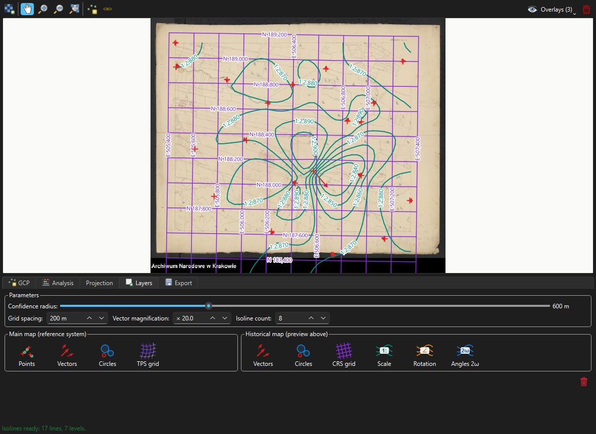

## 🆕 What's new in 0.3.0 „Falkenberg”

Version 0.3 turns QMapAnalyst from a single-map tool into a workbench for **series of maps**:

* **Reference point library** – one GeoPackage file with your control points (towns, churches, confluences…), historical names and coordinate uncertainty, grouped into **regional point sets**. Import from any vector layer (PRNG, OSM, BDOT10k) or CSV with duplicate detection; snapping, name search (also historical names, no diacritics needed) and **“Next from set”** with the predicted position on the scan.
* **Point quality per map** – status *sure / uncertain / illegible / not on map* with comments, optional **a priori weights** (status × coordinate uncertainty), links to the library kept in GCP files.
* **Maps and sheets** – map descriptions shared by all sheets, a **map frame** on the scan shown as the map extent on the modern map, and a **coverage matrix** point × map (present, uncertain, outlier, not on map, outside the sheet).
* **Time series** – maps from different years compared with one model: accuracy over time, point position errors, **residual similarity** (vector correlation with a permutation test – a trace of copying), error vectors and point trajectories on the map.
* **Multi-sheet publications** – sheet consistency (scale, rotation, RMSE), overlaps (points identified on two sheets) and a sheet index on the modern map.
* **Reports and charts** – PDF and HTML reports with charts, and every chart as SVG and PNG for slides.

| Library point on the GCP tab | Coverage matrix |
|---|---|
| 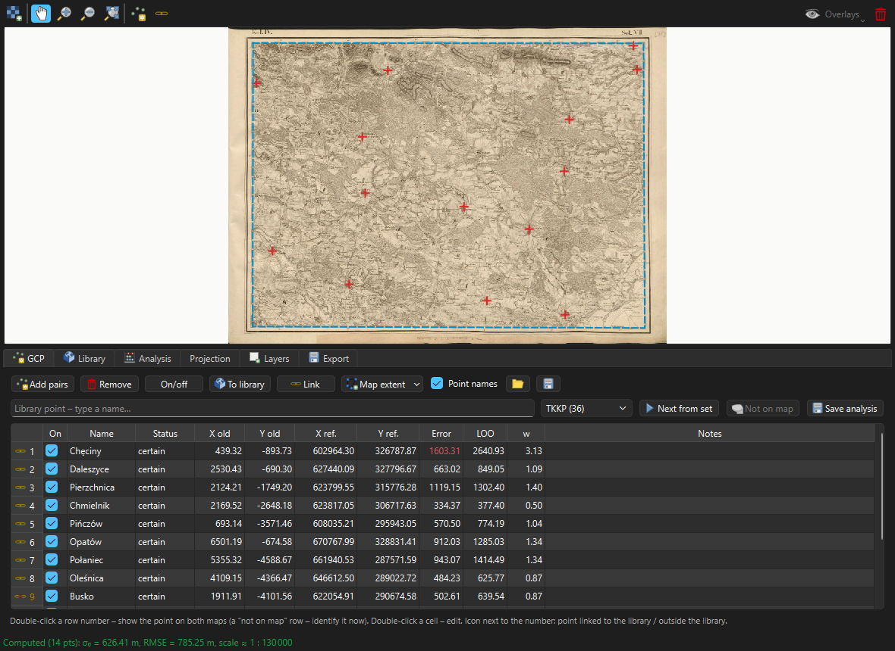 | 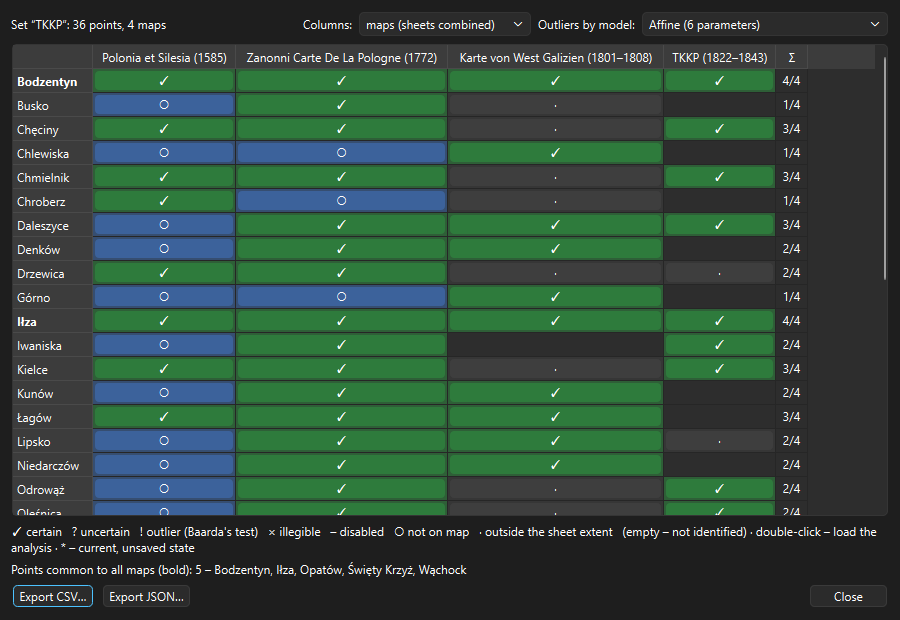 |

| Map accuracy over time | Error similarity between maps |
|---|---|
| 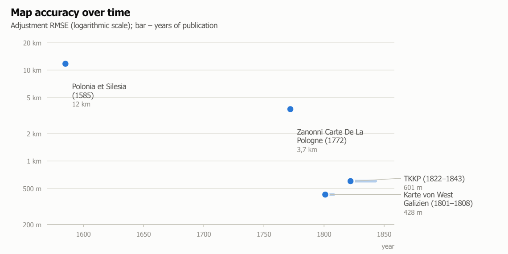 | 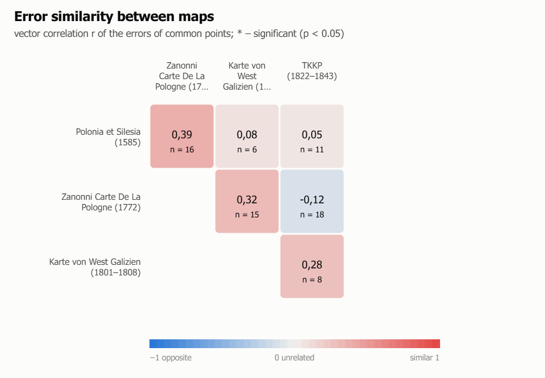 |

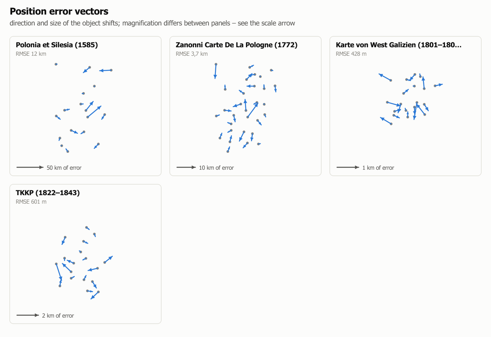

| Map extent on the modern map | Error vectors on the modern map |
|---|---|
| 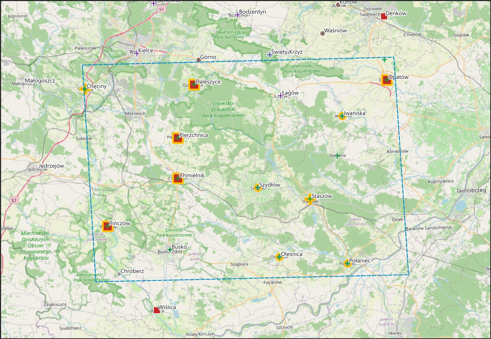 | 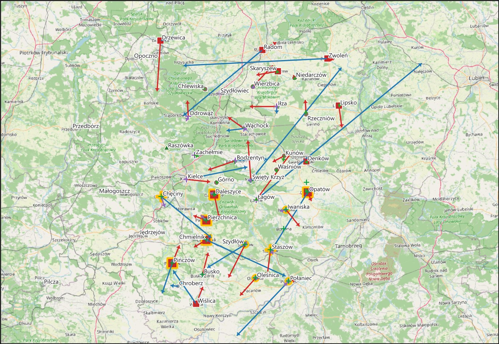 |

*Screenshots 0.3: point set „TKKP” (Kielce region) – Polonia et Silesia (1585), Rizzi Zannoni, Carte de la Pologne (1772), Karte von West-Galizien (1801–1808) and the Topographic Map of the Kingdom of Poland 1:126 000 (1822–1843); background © OpenStreetMap contributors.*

## 🌟 Key features

* **Transformations:** Helmert (4 parameters), affine (6) and 2nd-order polynomial (12), all fitted by least squares.
* **Statistics:**
  * σ₀, mean position error, RMSE (total / X / Y), CE90/CE95 and error on paper (mm)
  * standard errors of scale, rotation and shear
  * **leave-one-out cross-validation** and the **Baarda outlier test**
  * comparison of transformation models with **AICc**
  * **Moran's I** spatial autocorrelation of residuals
  * **Tissot-based local distortion** (scale variation, rotation, angular distortion 2ω)
* **Map projection estimation:** fits 15 projections that matter for 15th–20th-century cartography to the control points and ranks them by AICc with Akaike weights. The projections are Plate carrée, equirectangular, Mercator, Cassini–Soldner, Gauss–Krüger, Sanson–Flamsteed, Bonne, trapezoidal, De l'Isle equidistant conic, Lambert conformal conic, Albers, Lambert azimuthal, stereographic, Postel and Hassler polyconic. Projection parameters (λ₀, φ₀, φ₁, φ₂) come with standard errors, and λ₀ is also given relative to the Ferro, Paris, Pulkovo and Warsaw meridians. The plugin can draw the estimated **graticule on the scan** for visual comparison.
* **Visualisation:** displacement vectors (arrows) and error circles on both maps, a TPS distortion grid with reliable and extrapolated zones, a warped reference grid on the scan, isolines of scale, rotation and angular distortion with labels, and a GCP layer that carries all statistics as attributes.
* **Export:**
  * full analysis report as a paginated PDF (header, page numbers), aligned plain text (TXT) or HTML, covering input data, all statistics, the residual table of every point, the projection ranking and hypotheses
  * a PDF with one map page per overlay
  * a georeferenced TIFF view
  * CSV tables of points and of the projection ranking
* **Library, series and publications (0.3):** reference point library with regional sets, point status per map, maps and sheets, map frames, coverage matrix, time series of maps and multi-sheet publications with reports and charts – see above.
* **Workflow:**
  * continuous GCP capture and in-table coordinate editing
  * zoom to a point and synchronised views
  * the reference CRS is stored with the GCPs (`.points` / CSV)
  * automatic recomputation that refreshes existing result layers
* Works with QGIS 3.34+ (Qt5) and QGIS 4 (Qt6).
* **Bilingual:** the interface, the analysis report (panel and PDF), status and error messages, layer names and legends are available in Polish and English. The language follows the QGIS interface; any locale other than Polish uses English. Numbers in the Polish report use a decimal comma.

## 🚀 Installation

**Requirements:** NumPy and SciPy. Both are bundled with the official QGIS installers (Windows standalone/OSGeo4W, macOS), so usually nothing has to be installed. If a package is missing, the plugin says so and shows the install command for your platform; without SciPy it still works, but projection estimation, TPS local distortion and isolines are unavailable.

| Platform | Command |
|---|---|
| Windows – OSGeo4W | OSGeo4W Setup → *Advanced Install* → *Libs* → `python3-scipy` |
| Debian / Ubuntu | `sudo apt install python3-scipy` |
| Fedora | `sudo dnf install python3-scipy` |
| Arch Linux | `sudo pacman -S python-scipy` |
| Flatpak | `flatpak run --command=pip3 org.qgis.qgis install --user scipy` |
| conda | `conda install -c conda-forge scipy` |


**From the QGIS Plugin Repository:** *Plugins → Manage and Install Plugins…*, search for `QMapAnalyst`.

**From ZIP:**
1. Run `python build.py` or download a release.
2. Open *Plugins → Manage and Install Plugins… → Install from ZIP* in QGIS.

## 📖 Workflow

1. **Historical map:** load an ungeoreferenced scan into the plugin's own map view.
2. **GCP tab:** capture point pairs by clicking on the scan and then on the QGIS main map, or load them from `.points` or CSV. The table shows the error, LOO error and standardized residual of each point.
3. **Analysis tab:** pick a transformation and the scan DPI, then read the report: accuracy, parameters with errors, map scale, outliers, model comparison, local distortion and autocorrelation.
4. **Projection tab:** estimate the map projection, inspect the ranking and its parameters, and draw the graticule on the scan.
5. **Layers tab:** generate result layers on the main map and on the scan.
6. **Export tab:** save a PDF report, TIFF and CSV files.
7. **Library tab (0.3):** open or create a point library, choose a point set, save the analysis as a sheet of a map, then open the **coverage matrix**, the **time series** or – from *Maps and sheets* – a **multi-sheet publication**.

| GCP table | Analysis report | Projection estimation |
|---|---|---|
| 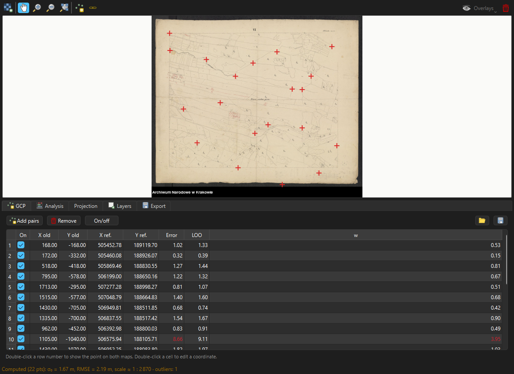 | 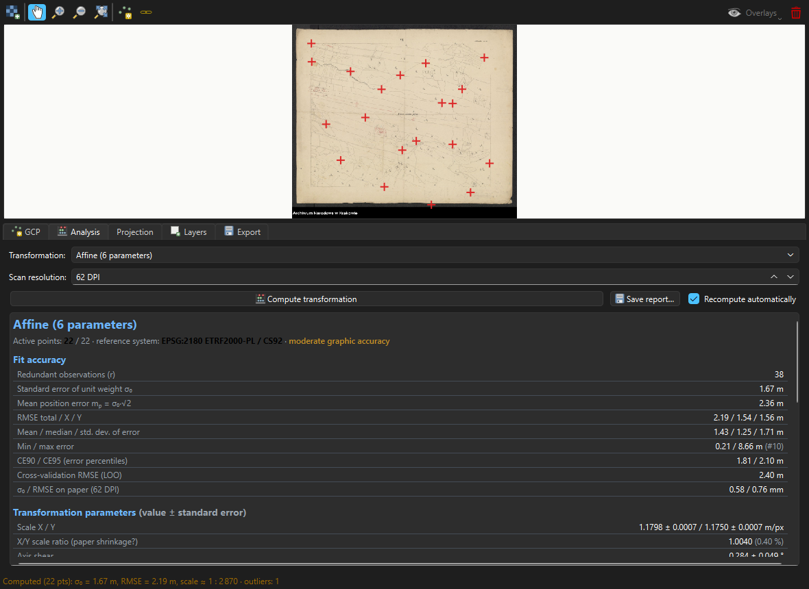 | 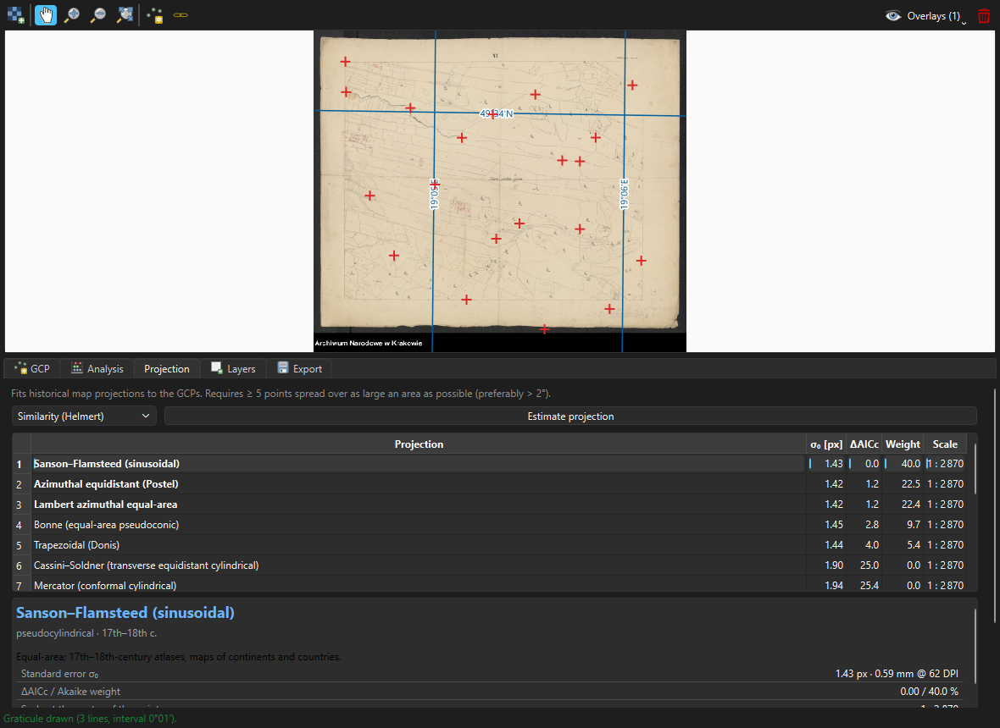 |

*Screenshots: sheet VI of the Austrian cadastral indication sketch of Milówka (1:2880, National Archives in Kraków); the GCPs are for demonstration only.*

A detailed manual (in Polish) is available in [docs/manual_qmapanalyst.md](docs/manual_qmapanalyst.md).

### Notes on projection estimation

* Projections differ measurably only over larger areas. With points spanning less than about 2°, or with σ₀ differences under 10 %, the plugin warns that the result is only indicative.
* Gross errors in GCPs bias the projection parameters. The plugin flags suspect points; disable them and run the estimation again.
* The computations use a sphere. Geographic coordinates are derived from the project's reference CRS.
* The method follows the approach of T. Bayer, *Estimation of an unknown cartographic projection and its parameters from the map* (GeoInformatica, 2014), and B. Jenny's MapAnalyst.

## 🧪 Development

```bash
# engine tests (no GUI) – OSGeo4W shell
python-qgis.bat tests/test_engine.py
# library, coverage, series, publications, charts (no GUI)
python-qgis.bat tests/test_library.py
python-qgis.bat tests/test_series.py
python-qgis.bat tests/test_charts.py
# full offscreen smoke test of the panel (and tests/library_*_qgis.py)
set QT_QPA_PLATFORM=offscreen && python-qgis.bat tests/smoke_qgis.py
# regenerate translations (.ts/.qm)
python-qgis.bat i18n/build_translations.py
```

Module layout: `math_engine.py` (transformations and statistics), `projections.py` (projection estimation), `report.py` (HTML reports), `layers.py` (result layer registry and styles), `export.py` (PDF/CSV), `dockwidget.py` (UI). Version 0.3: `library.py` (point library, GeoPackage), `coverage.py`, `series.py`, `publication.py` and `charts.py` (computations and SVG charts without QGIS), `library_panel.py`, `maps_dialog.py`, `coverage_dialog.py`, `series_dialog.py`, `publication_dialog.py`, `series_report.py` (UI and reports).

## 📄 License

GNU General Public License v3.0 – see [LICENSE](LICENSE).

## 👤 Author

**Tomasz Nycz** – [GitHub](https://github.com/merkato)
*If you use this plugin in academic research, please consider citing it.*
