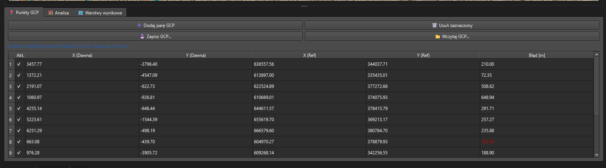

# QMapAnalyst

**QMapAnalyst** is a modern, advanced QGIS plugin designed for the cartometric analysis of historical maps. Inspired by the classic MapAnalyst software, this tool allows researchers, cartographers, and historians to evaluate local map distortions, calculate historical paper scales, and visualize spatial displacement errors entirely within the native QGIS environment.

## 🌟 Key Features

* **Cartometric Analysis:** Comprehensive evaluation of historical map accuracy compared to modern reference systems (e.g., EPSG:2180 / PUWG 1992).
* **Coordinate Transformations:** Supports both **Helmert** (4-parameter: scale, rotation, translation) and **Affine** (6-parameter, including shear) transformations.
* **Error Visualization:** Generates scalable **displacement vectors** and **error circles** to highlight local deviations between the historical scan and modern ground truth.
* **Distortion Grids (RBF):** Calculates and draws advanced distortion grids using Radial Basis Functions (Thin Plate Splines). The grids intelligently mask reliable areas vs. extrapolated zones based on a user-defined confidence radius.
* **Scale and Rotation Isolines:** Generates continuous isolines representing local map scale variations and rotation angles, overlaid directly on the historical pixel space.
* **Automatic Labeling:** Implements QGIS PAL engine (`QgsPalLayerSettings`) for automatic, cartographically readable labeling of scale denominators (e.g., `1 : 135 000`) and rotation angles (e.g., `-2.5°`).
* **Clean Integration:** Automatically groups and cleans up generated temporary layers from the QGIS project to keep your workspace organized.

## 🚀 Installation

### Option 1: Via QGIS Plugin Repository (Recommended)
*Once published in the official repository:*
1. Open QGIS.
2. Go to **Plugins > Manage and Install Plugins...**
3. Search for `QMapAnalyst` and click **Install Plugin**.

### Option 2: Manual Installation from ZIP
1. Download the latest `QMapAnalyst.zip` release from the GitHub repository.
2. Open QGIS and navigate to **Plugins > Manage and Install Plugins...**
3. Select the **Install from ZIP** tab.
4. Browse to the downloaded `.zip` file and click **Install Plugin**.

## 📖 Usage & Workflow

The plugin operates via a dockable widget (docked on the right by default) and is divided into three main operational tabs.

### 1. GCP Points (Ground Control Points)
Start by loading a raw, unreferenced historical map scan (pixels). Use this tab to capture point pairs between the historical map canvas and the main QGIS reference map. 

> **  

* Enable or disable specific GCPs on the fly to see how they affect the transformation.
* Save and load GCP sets using standard CSV or QGIS `.points` formats.

### 2. Analysis & Transformation
Once you have enough active GCPs (min. 2 for Helmert, 3 for Affine), navigate to the Analysis tab to compute the mathematical model.

> **  

* Instantly view the RMSE (Root Mean Square Error), Min/Max errors, and global rotation angle.
* Estimate the original paper scale based on standard scanning resolutions (150, 300, 600 DPI).

### 3. Result Layers
This tab is the core of the cartometric visualization. Set your grid step (in meters) and confidence radius, then generate analytical geometry.

> **  

* **Main Map Generations:** Create displacement vectors, error circles, and RBF distortion grids that align with your modern reference CRS.
* **Historical Map Generations:** Project warped modern grids (e.g., PUWG 1992) and automated scale/rotation isolines back onto the historical pixel space.

## 📄 License

This project is licensed under the MIT License - see the [LICENSE](LICENSE) file for details.

## 👤 Author

**Tomasz Nycz**  
[GitHub Profile](https://github.com/merkato)  
*If you use this plugin in academic research, please consider citing it!*