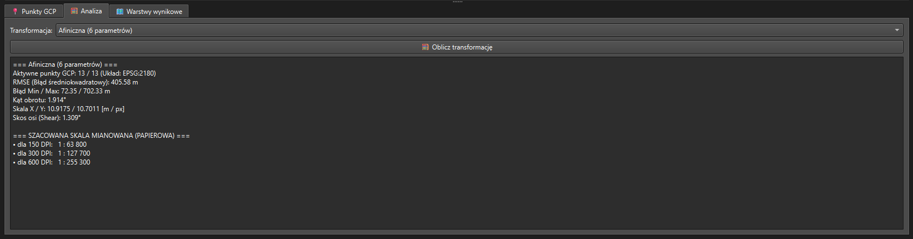
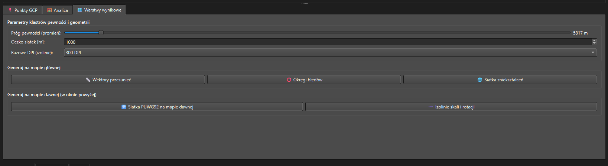

# Instrukcja obsługi wtyczki QMapAnalyst

**QMapAnalyst** to zaawansowana wtyczka do programu QGIS, służąca do kartometrycznej analizy dawnych map. Inspirując się klasycznym oprogramowaniem MapAnalyst, wtyczka pozwala na badanie lokalnych zniekształceń, obliczanie skali papierowej oraz wizualizację błędów i rotacji historycznych arkuszy za pomocą siatek (RBF), wektorów i izolinii – a to wszystko w natywnym środowisku QGIS.

---

## 1. Wczytanie mapy dawnej

Pracę z wtyczką rozpoczynamy od załadowania surowego, niezgeoreferowanego skanu mapy dawnej (piksele).

1. Otwórz panel wtyczki QMapAnalyst (domyślnie dokowany po prawej stronie ekranu).
2. W górnej sekcji **Mapa dawna (Skan / Piksele)** kliknij przycisk **Wczytaj skan...**.
3. Wybierz plik rastrowy (np. `.tif`, `.jpg`, `.png`).
4. Skan zostanie załadowany do dedykowanego, niezależnego okna podglądu we wtyczce. Do poruszania się po skanie używaj przycisków **Przesuwaj** oraz **Pełny widok**.

*(Uwaga: Przycisk **🧹 Wyczyść nakładki** służy do szybkiego usuwania wygenerowanych później linii i siatek z okna podglądu, aby przywrócić czysty widok mapy).*

---

## 2. Zakładka: 📍 Punkty GCP

W tej zakładce definiujemy punkty kontrolne (Ground Control Points - GCP), które łączą piksele mapy dawnej z rzeczywistymi współrzędnymi referencyjnymi (np. w układzie PUWG 1992 na głównej mapie QGIS).

### Dodawanie punktów:
1. Kliknij **➕ Dodaj parę GCP** (przycisk wciśnie się).
2. **Krok 1:** Kliknij charakterystyczny punkt na podglądzie **Mapy dawnej** (we wtyczce). Pojawi się czerwony krzyżyk.
3. **Krok 2:** Kliknij odpowiadający mu punkt na **Mapie głównej QGIS** (referencyjnej). Pojawi się zielony krzyżyk, a para zostanie dodana do tabeli.

### Zarządzanie punktami:
* **Włączanie/wyłączanie:** Zaznaczenie checkboxa w pierwszej kolumnie (`Akt.`) pozwala tymczasowo wykluczyć punkt z analizy. Znaczniki wyłączonego punktu zmienią kolor na szary, a cała matematyka przeliczy się automatycznie.
* **Usuwanie:** Zaznacz wiersz w tabeli i kliknij **🗑️ Usuń zaznaczony**.
* **Zapis / Odczyt:** Użyj przycisków **💾 Zapisz GCP...** i **📂 Wczytaj GCP...**, aby wyeksportować/zaimportować punkty (obsługiwany format QGIS `.points` oraz zwykły `.csv`).

---

## 3. Zakładka: 🧮 Analiza

Kiedy posiadasz już wystarczającą liczbę aktywnych punktów GCP (minimum 2 dla transformacji Helmerta, 3 dla afinicznej), możesz przejść do obliczeń.

1. Z rozwijanej listy wybierz **Typ transformacji**:
   * **Helmert (4 parametry)** – zachowuje kształty, pozwala na przesunięcie, obrót i jednolitą zmianę skali.
   * **Afiniczna (6 parametrów)** – pozwala na niezależną zmianę skali w osiach X i Y oraz skoszenie (shear).
2. Kliknij **🧮 Oblicz transformację**.
3. W oknie tekstowym pojawi się szczegółowy raport zawierający:
   * Wartość błędu średniokwadratowego (**RMSE**).
   * Błędy minimalne i maksymalne.
   * Kąt obrotu arkusza.
   * Skalę pikselową [m/px].
   * Szacowaną **skalę mianowaną (papierową)** dla popularnych rozdzielczości skanowania (150, 300, 600 DPI).
4. W tabeli GCP (w pierwszej zakładce) zaktualizuje się kolumna **Błąd [m]**, a punkt o największym błędzie zostanie podświetlony na czerwono.

---

## 4. Zakładka: 🗺️ Warstwy wynikowe

To najważniejsza zakładka wtyczki. Pozwala na wizualizację deformacji w oparciu o wcześniej wykonane obliczenia. Składa się z dwóch głównych sekcji generowania.

### Parametry bazowe:
* **Próg pewności (promień):** Określa strefę wokół punktów GCP, którą uznajemy za wiarygodną. Geometrie wykraczające poza te strefy (ekstrapolacja) będą rysowane przerywaną linią i innym kolorem.
* **Oczko siatek [m]:** Odległość w metrach między liniami wygenerowanych siatek (np. 1000 m dla klasycznej siatki kilometrowej).
* **Bazowe DPI (izolinie):** Rozdzielczość używana do poprawnego obliczenia etykiet izolinii skali mianowanej na mapie dawnej.
* **Mnożnik skali błędów:** Pozwala powiększyć wizualnie małe błędy (np. 10x), aby były czytelne na mapie poglądowej (dotyczy wektorów i okręgów).

### Generowanie na mapie głównej (PUWG 1992):
Warstwy te trafiają do głównego panelu warstw QGIS i są renderowane w metrycznym układzie współrzędnych projektu.
* **📏 Wektory przesunięć:** Rysuje wektory (od ztransformowanej pozycji na mapie dawnej do punktu referencyjnego).
* **⭕ Okręgi błędów:** Rysuje strefy błędu wokół punktów kontrolnych.
* **🌐 Siatka zniekształceń:** Generuje siatkę lokalnych deformacji (z użyciem funkcji RBF). Solidna linia oznacza obszar wewnątrz maski pewności, przerywana - ekstrapolację.

### Generowanie na mapie dawnej (w oknie wtyczki):
Te warstwy są rzutowane na przestrzeń pikselową mapy dawnej. Są dodawane do legendy QGIS (aby móc podejrzeć ich atrybuty), ale domyślnie mają wyłączoną widoczność na mapie głównej.
* **🛜 Siatka PUWG92 na mapie dawnej:** Nakłada wygiętą, współczesną siatkę kilometrową na historyczny skan.
* **〰️ Izolinie skali i rotacji:** Oblicza lokalne wahania skali oraz kąta skręcenia mapy (przy użyciu interpolacji RBF) i rysuje izolinie opatrzone automatycznymi etykietami.

*Każde kolejne kliknięcie w przycisk generowania usuwa stare warstwy z danego typu i zastępuje je nowymi, dzięki czemu projekt utrzymuje porządek (warstwy posiadają prefiks `QMapAnalyst -`).*