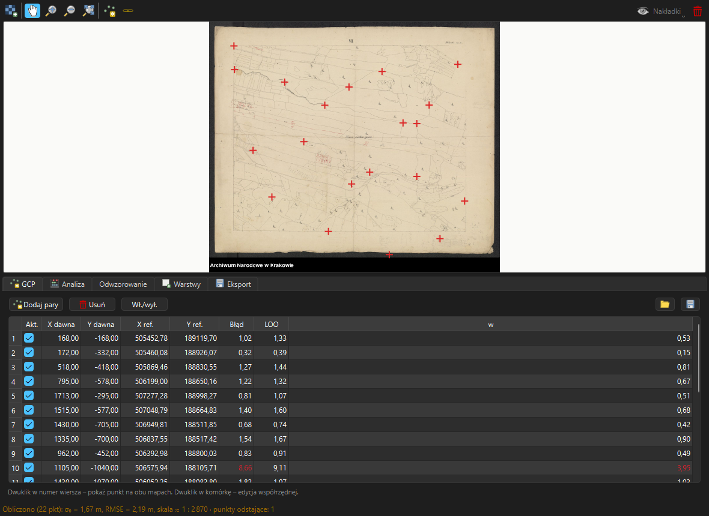
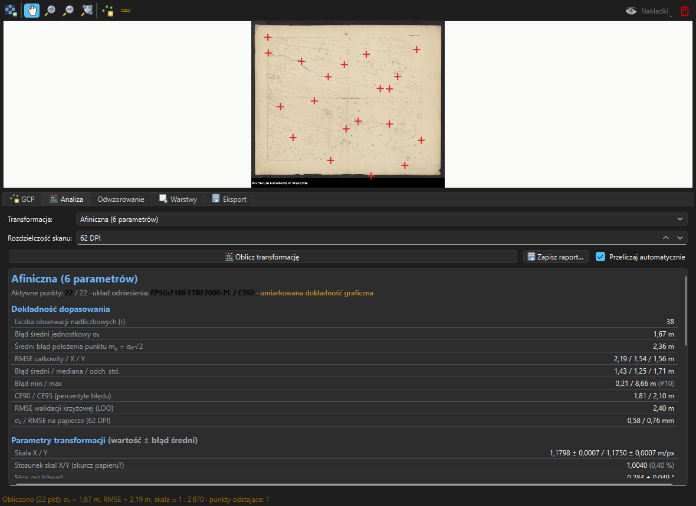
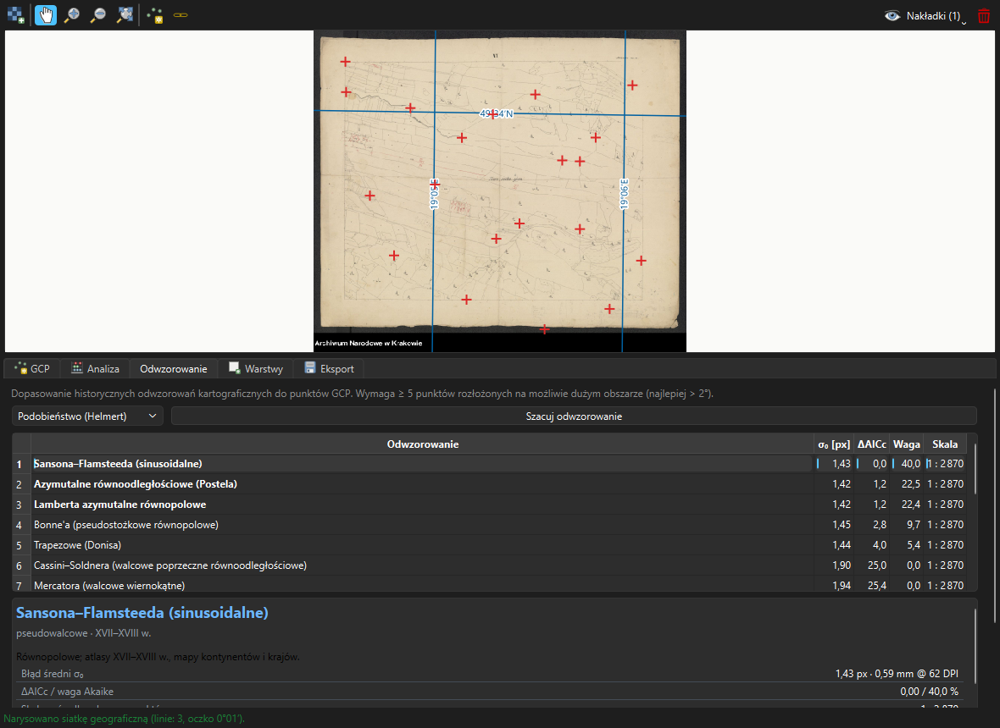
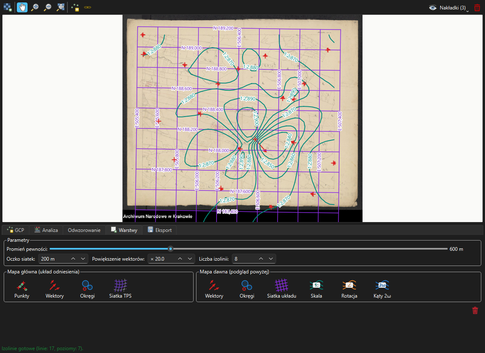

# Instrukcja obsługi wtyczki QMapAnalyst

**QMapAnalyst** to wtyczka QGIS do kartometrycznej analizy dawnych map. Inspirowana programem MapAnalyst pozwala badać dokładność i lokalne zniekształcenia mapy, szacować jej skalę papierową oraz **odwzorowanie kartograficzne, w jakim została wykonana** – w całości w środowisku QGIS.

> Ilustracje przedstawiają arkusz VI szkicu indykacyjnego katastru austriackiego gminy Milówka (skala 1:2880, Archiwum Narodowe w Krakowie). Punkty GCP na ilustracjach są demonstracyjne – służą pokazaniu interfejsu, a nie są georeferencją arkusza.

---

## 1. Mapa dawna

Panel wtyczki (domyślnie po prawej stronie) zawiera u góry podgląd skanu mapy dawnej z paskiem narzędzi:

| Przycisk | Działanie |
|---|---|
| Wczytaj skan | wczytuje niezgeoreferowany skan (`.tif`, `.jpg`, `.png`, `.jp2`…) |
| Przesuwanie / powiększanie / pomniejszanie / pełny widok | nawigacja po skanie (pod podglądem widać współrzędne kursora w pikselach) |
| Dodaj GCP | tryb dodawania par punktów (patrz niżej) |
| Synchronizuj | po obliczeniu transformacji mapa główna QGIS podąża za widokiem skanu |
| Nakładki (n) | rozwija listę nakładek wygenerowanych na mapie dawnej – zaznaczenie decyduje o ich widoczności (także na stronach PDF z mapami) |
| Kosz (u góry) | usuwa wszystkie nakładki z podglądu mapy dawnej |

Dolny panel z zakładkami można zmniejszyć, przeciągając uchwyt między nim a podglądem – zawartość zakładek jest wtedy przewijana. Nakładki te żyją w przestrzeni pikseli skanu, dlatego **nie są dodawane do drzewa warstw** mapy głównej.

---

## 2. Zakładka GCP

1. Włącz **Dodaj pary** (lub przycisk na pasku mapy dawnej).
2. Kliknij punkt na skanie (żółty znacznik), a potem odpowiadający mu punkt na mapie głównej QGIS.
3. Tryb pozostaje aktywny – możesz od razu dodawać kolejne pary. Wyłącz go ponownym kliknięciem. Zmiana narzędzia mapy głównej w trakcie kroku 2 anuluje bieżący punkt.

**Wspomaganie dodawania punktów:** przy włączonym *Przeliczaj automatycznie* transformacja liczy się sama, gdy tylko jest wystarczająco wiele punktów (Helmert – 2, afiniczna – 3), bez ręcznego klikania *Oblicz*. Od tej chwili:

* w kroku 2 na mapie głównej pojawia się **żółte kółko** w przewidywanym położeniu punktu,
* po włączeniu **Synchronizuj** mapa główna centruje się na tym położeniu, a widoki obu map podążają za sobą **w obie strony** (przesuwanie/powiększanie jednej mapy przesuwa drugą).

Im więcej punktów, tym trafniejsze przewidywanie (powyżej 3 punktów uwzględniane są też lokalne zniekształcenia mapy).

Tabela punktów:

* **Akt.** – włącza/wyłącza punkt w obliczeniach (przycisk *Wł./wył.* przełącza wszystkie zaznaczone),
* **X/Y dawna, X/Y ref.** – współrzędne; dwuklik w komórkę pozwala je poprawić,
* **Błąd** – odległość punktu transformowanego od referencyjnego (czerwony = największy lub odstający),
* **LOO** – błąd walidacji krzyżowej: jak daleko „chybia” punkt, gdy transformację wyznaczono bez niego,
* **w** – reszta standaryzowana (test Baardy); |w| > 3,29 oznacza punkt podejrzany o błąd identyfikacji.

Dwuklik w numer wiersza centruje oba widoki na punkcie; zaznaczone punkty są wyróżnione na obu mapach.

**Układ odniesienia** punktów jest zapamiętywany przy pierwszym punkcie (lub odczytywany z nagłówka `#CRS` pliku `.points`). Późniejsza zmiana układu projektu nie psuje już współrzędnych – znaczniki są przeliczane automatycznie.

Zapis/odczyt: format Georeferencera QGIS (`.points`) oraz CSV (separator `,` lub `;`). Przy wczytywaniu możesz zastąpić istniejące punkty albo je uzupełnić; niepoprawne wiersze są pomijane z informacją.

**Nazwy punktów.** Po zaznaczeniu przełącznika *Nazwy punktów* wtyczka po wskazaniu każdej pary pyta o nazwę (Anuluj – para nie zostanie dodana) i pokazuje kolumnę *Nazwa* (dwuklik – edycja). Nazwy pojawiają się w raporcie (np. „#5 Kościół”), w warstwie punktów GCP i w eksporcie CSV.
* CSV – nazwa jest dodatkową kolumną `name`.
* `.points` – plik pozostaje dokładnie w formacie Georeferencera QGIS, a nazwy trafiają do pliku towarzyszącego `<plik>.points.names.csv` (`id,name,sourceX,sourceY,mapX,mapY,uid,status,comment`). Przy wczytywaniu nazwy są przypisywane po współrzędnych skanu, więc przetrwają zmianę kolejności, dodanie lub usunięcie punktów w Georeferencerze; gdy liczba punktów się zgadza, punkty o poprawionych współrzędnych dostają nazwę po numerze. Zapis bez nazw usuwa nieaktualny plik towarzyszący.
* **Powiązanie z biblioteką** – CSV i plik towarzyszący `.points` przechowują też identyfikator punktu biblioteki (`uid`), status i uwagi, a plik towarzyszący dodatkowo punkty „brak na mapie” (wiersze bez współrzędnych). Po wczytaniu pliku punkty są od razu powiązane z biblioteką – nie trzeba ich ponownie wiązać. Powiązanie z punktem, którego nie ma w otwartej bibliotece (lub który jest już w analizie), jest pomijane; gdy punkt w bibliotece zmienił położenie, wtyczka zapyta o aktualizację współrzędnych.

**Punkty z biblioteki** (gdy otwarta jest biblioteka punktów – zakładka *Biblioteka*):
* **Przyciąganie** – w kroku 2/2 kliknięcie w pobliżu (do 10 px) punktu widocznej warstwy biblioteki bierze dokładne współrzędne, nazwę i identyfikator tego punktu. Kliknięcie dalej, ale do 40 px od punktu biblioteki, kończy się pytaniem, czy powiązać parę z tym punktem (*Nie* – punkt spoza biblioteki w miejscu kliknięcia).
* **Wyszukiwarka** pod przyciskami – wpisz nazwę (także dawną, bez polskich znaków); wyniki z wybranego zestawu, uporządkowane także według odległości od położenia przewidywanego (przy tej samej nazwie w kilku miejscach właściwy punkt jest zwykle pierwszy). Wybrany punkt zaznacza się kwadratem na mapie głównej – wystarczy kliknąć go na mapie dawnej. Jeśli punkt na skanie wskazano już wcześniej (krok 2/2), para powstaje od razu – to celowy sposób pracy: klik na skanie, potem nazwa.
* **Następny z zestawu** – kolejny punkt wybranego zestawu, którego nie ma jeszcze w analizie (najbliższy ostatnio dodanemu). Po obliczeniu transformacji żółte kółko na mapie dawnej pokazuje, gdzie go szukać. Ponowne kliknięcie pomija punkt (np. nieobecny na mapie). Punkt wskazany wcześniej na skanie (zaczęty krok 1/2) jest odrzucany – nie połączy się z punktem z zestawu.
* Ten sam punkt biblioteki nie może wystąpić w analizie dwa razy.
* **Brak na mapie** – oznacza bieżący punkt z biblioteki jako nieobecny na tej mapie (np. wieś pominięta przez kartografa) z uwagą. To informacja, nie błąd: punkt nie wchodzi do obliczeń, „Następny z zestawu” go pomija, a zapis analizy go zachowuje. Punkty „brak na mapie” są wierszami na końcu tabeli (○, bez położenia na skanie): uwagi można edytować, *Usuń* zdejmuje oznaczenie, a dwuklik w numer wiersza pozwala jednak wskazać punkt na mapie dawnej.
* **Powiązanie z biblioteką widać przy numerze wiersza** (gdy biblioteka jest otwarta): ikona łącza – punkt biblioteki (podpowiedź podaje jego nazwę i ostrzega, gdy nazwa w tabeli jest inna), przekreślone łącze – punkt spoza biblioteki. **Tylko punkty powiązane trafiają do macierzy pokrycia.**
* **Powiąż** – zaznaczone (bez zaznaczenia – wszystkie) punkty spoza biblioteki wiąże z istniejącymi punktami biblioteki: o tej samej nazwie (także dawnej) do 5 km, a bez takiej – z najbliższym do 500 m. Przed zmianą pokazuje listę propozycji z odległościami; współrzędne odniesienia są zastępowane współrzędnymi z biblioteki. Punkty bez dopasowania można dodać przyciskiem *Do biblioteki*.
* **Zapisz analizę** (obok *Brak na mapie*) – to samo co w zakładce *Biblioteka*. Gwiazdka i pogrubienie (*Zapisz analizę \**) oznaczają niezapisane zmiany: plik biblioteki ma ostatni zapis, a macierz pokrycia pokazuje dla otwartej analizy stan bieżący (kolumna z \*). Przy wczytywaniu innej analizy wtyczka proponuje zapis zmian (*Tak*), ich porzucenie (*Nie*) albo rezygnację.

**Zasięg mapy.** Przycisk *Zasięg mapy* ustala ramkę mapy na skanie: *Wskaż 4 rogi ramki na skanie* (cztery kliknięcia na mapie dawnej – rogi ramki mapy, bez marginesów, legendy i opisu) albo *Zasięg = cały skan* (domyślnie). Ramka jest widoczna na mapie dawnej; po obliczeniu transformacji jej obraz – **zasięg mapy na mapie współczesnej** – widać na mapie głównej (*Pokaż zasięg na mapie głównej*). *Następny z zestawu* pomija punkty zestawu leżące poza zasięgiem (komunikat podaje ich liczbę), a macierz pokrycia oznacza je jako „poza zasięgiem arkusza” zamiast pustej komórki. Ramka zapisywana jest w analizie we współrzędnych skanu (dane wejściowe); zasięg na mapie współczesnej liczy się na bieżąco z transformacji, więc poprawia się wraz z kolejnymi punktami.

**Status i uwagi.** Kolumna *Status* (dwuklik – lista) opisuje identyfikację punktu na tej mapie: *pewny*, *niepewny* albo *nieczytelny*. Punkt nieczytelny nie wchodzi do obliczeń (jak wyłączony), ale zostaje w analizie. Kolumna *Uwagi* przechowuje komentarz do punktu na tej mapie.

**Do biblioteki.** Zaznaczone w tabeli punkty GCP można dodać do biblioteki punktów (ich współrzędne odniesienia, przeliczone do układu biblioteki) – oraz do zestawu wybranego w zakładce *Biblioteka*. Punkt leżący już w bibliotece (do 1 m) zostaje powiązany z istniejącym, a nie zdublowany. Punkt bez nazwy dostaje nazwę „GCP n”, a źródłem staje się nazwa skanu.

---

## 3. Zakładka Biblioteka *(wersja rozwojowa 0.3)*

Biblioteka punktów referencyjnych to jeden plik GeoPackage użytkownika, wspólny dla wszystkich projektów i analiz. Przechowuje punkty (miejscowości, kościoły, ujścia rzek…) wraz z nazwami dawnymi, typem, wskazanym obiektem i niepewnością współrzędnych oraz **zestawy** – np. regionalne, jak „Kielecczyzna-18”. Ten sam punkt może należeć do wielu zestawów.

* **Otwórz / Nowa** – wybór pliku biblioteki lub założenie nowego (z wyborem układu współrzędnych, domyślnie układ projektu). Ścieżka jest zapamiętywana.
* **Warstwa na mapie głównej** – punkty biblioteki na mapie QGIS: symbol według typu, etykieta z nazwą, podpowiedź z nazwami dawnymi. Punkty użyte w bieżącej analizie mają żółtą obwódkę.
* **Zestaw** – zestaw roboczy: do niego dodajesz i z niego usuwasz punkty, z niego korzystają *Następny z zestawu*, wyszukiwarka i macierz pokrycia. Ta sama lista jest w zakładce *GCP* obok *Następny z zestawu*. Punkty spoza zestawu są na mapie przygaszone – można je zaznaczyć i dodać przyciskiem *Dodaj zaznaczone*. **Tylko punkty zestawu** ukrywa je całkiem.
* **Menu zestawów** (przycisk obok listy): *Nowy zestaw z zaznaczonych…* (punkty zaznaczone na warstwie biblioteki zwykłym narzędziem zaznaczania QGIS; bez zaznaczenia – pusty), *Nowy zestaw z punktów analizy…* (punkty biblioteki bieżącej analizy, także „brak na mapie”), *Punkty zestawu…* (lista z nazwami dawnymi i typem; dwuklik pokazuje punkt na mapie głównej i zaznacza go; *Usuń z zestawu*), *Zmień nazwę…*, *Usuń zestaw…*.
* **Dodaj zaznaczone / Usuń zaznaczone** – zmiana składu wybranego zestawu. Usunięcie z zestawu ani usunięcie zestawu nie usuwa punktów z biblioteki.

**Import punktów** (*Importuj…*). Źródłem jest dowolna warstwa wektorowa projektu (np. miejscowości z PRNG, obiekty z OSM lub BDOT10k – dla linii i poligonów brany jest punkt wewnątrz obiektu; opcjonalnie tylko zaznaczone obiekty) albo plik CSV (separator i kodowanie rozpoznawane automatycznie, przecinek dziesiętny dozwolony; wskazujesz kolumny X/Y i układ współrzędnych). Pola są dopasowywane automatycznie po nazwach (np. `NAZWA_GLOWNA`, `RODZAJ_OBIEKTU`, `name`, `place`, `old_name`) i można je zmienić. Wartości typu są rozpoznawane po polsku, angielsku i niemiecku (miasto/town/Stadt, wieś/village/hamlet, kościół/church…); nierozpoznane dostają *typ domyślny*. Punkt w zadanym promieniu od istniejącego, o tej samej nazwie (także dawnej, bez polskich znaków), jest **duplikatem** i nie zostanie dodany – można za to dopisać jego nowe nazwy dawne do istniejącego punktu. Punkty bliskie istniejącym, ale o innej nazwie (np. kościół i dwór w jednej wsi), są dodawane i liczone w komunikacie. Zaimportowane punkty (oraz istniejące duplikaty) mogą od razu trafić do zestawu – istniejącego lub nowego.

**Mapy i arkusze.** Biblioteka przechowuje **mapy** (dzieło lub wydanie: tytuł, autor, rok od–do, skala nominalna) i ich **arkusze** – arkusz to analiza jednego skanu: położenie punktów na skanie, współrzędne odniesienia (kopia z chwili powiązania), status, uwagi i punkty „brak na mapie”, a także numer arkusza, DPI, uwagi i odcisk pliku skanu (SHA-256). Opis mapy jest wspólny dla wszystkich jej arkuszy – zmiana tytułu czy roku obejmuje je wszystkie. Zapisywane są dane wejściowe, nie wyniki – wynik przelicza się po wczytaniu.

* **Zapisz analizę** – ponowny zapis zastępuje punkty otwartego arkusza. Przy pierwszym zapisie okno opisu ma listę **Mapa**: wybierz mapę, której arkuszem jest skan (wtyczka podpowiada mapę o tytule zgodnym z nazwą warstwy skanu), albo *Nowa mapa…*; podaj numer arkusza. Jeśli skan ma już analizę w bibliotece, wtyczka najpierw pyta, czy ją zastąpić.
* **Opis mapy…** – zmiana opisu mapy i arkusza; wybranie innej mapy z listy przenosi arkusz.
* **Mapy i arkusze…** – drzewo map z arkuszami (liczba punktów, skan, data zmiany; arkusz otwarty w panelu GCP jest pogrubiony): *Nowa mapa…*, *Zapisz punkty jako nowy arkusz…* zaznaczonej mapy, *Edytuj…* (mapa – opis; arkusz – opis z wyborem mapy), *Usuń…* (mapa razem z arkuszami i ich punktami – z potwierdzeniem; usunięcie otwartego arkusza zostawia punkty w panelu jako niezapisane), *Wczytaj* (dwuklik) – przywraca punkty i – gdy trzeba – sam skan.
* Jeśli po zapisaniu arkusza punkt w bibliotece poprawiono, wtyczka pokaże różnicę i zapyta o aktualizację współrzędnych; punkt usunięty z biblioteki zostaje w analizie jako punkt spoza biblioteki.
* Biblioteki z wersji 0.3.0-dev sprzed podziału na mapy są uaktualniane przy otwarciu (arkusze o tym samym tytule trafiają do jednej mapy; dochodzi pole ramki mapy). Przedtem powstaje kopia pliku `<nazwa>.v<wersja>.bak.gpkg`.

**Macierz pokrycia** (*Macierz pokrycia…*, dla wybranego zestawu). Wiersze to punkty zestawu, kolumny – analizy map zapisane w bibliotece, które zawierają choć jeden punkt zestawu (uporządkowane według roku; mapy bez daty na końcu). Komórka: ✓ pewny, ? niepewny, ! odstający, × nieczytelny, – wyłączony, ○ brak na mapie, · poza zasięgiem arkusza (ramka mapy przeliczona transformacją arkusza – wymaga dość punktów do wyrównania), puste – jeszcze nie wskazany. Odstające wyznacza test Baardy w wyrównaniu każdej mapy wybranym modelem (domyślnie afinicznym) – liczone na żądanie z zapisanych punktów; przy zbyt małej liczbie punktów mapa nie jest badana (podpowiedź w nagłówku). Kolumna Σ podaje, na ilu mapach punkt jest obecny. Pogrubione są **punkty wspólne wszystkim mapom** – wspólne minimum do porównań między mapami; na czerwono – punkty **odstające na co najmniej dwóch mapach** (podejrzenie błędnej identyfikacji lub zmiany położenia obiektu). Kolumny to **arkusze** albo **mapy** (przełącznik *Kolumny*): w trybie map arkusze jednej mapy tworzą jedną kolumnę – punkt obecny na którymkolwiek arkuszu jest obecny na mapie, odstający na którymkolwiek – odstający; dwuklik w kolumnę mapy wieloarkuszowej pyta, który arkusz wczytać. Analiza otwarta w panelu GCP jest pokazana w stanie bieżącym – także niezapisanym (gwiazdka w nagłówku), a analiza jeszcze niezapisana dochodzi jako osobna kolumna. Dwuklik w kolumnę wczytuje analizę tej mapy. Eksport do CSV (kody komórek) i JSON (z listą punktów wspólnych i powtarzających się odstających).

**Seria czasowa** (*Seria czasowa…*, dla wybranego zestawu) – porównanie **map z różnych lat**, liczone na żądanie z arkuszy zapisanych w bibliotece (oraz bieżącego, niezapisanego stanu analizy otwartej w panelu GCP – oznaczonego \*). Elementem serii jest **mapa**: wydawnictwo wieloarkuszowe to jeden element (jeden punkt w czasie) – jego arkusze wyrównywane są osobno, a wyniki łączone (σ₀ i RMSE łączne, skala i obrót – średnie arkuszy, punkt na zakładce dwóch arkuszy – średni błąd). Wszystkie mapy i arkusze wyrównywane są **tym samym modelem** (domyślnie afinicznym), więc ich statystyki są porównywalne. Zgodność arkuszy jednego wydawnictwa bada osobny tryb – *Wydawnictwo wieloarkuszowe*.

* **Mapy** – dla każdej mapy (według roku): arkusze (numer albo liczba – lista w podpowiedzi), liczba punktów, σ₀, RMSE i błąd maksymalny w metrach, skala nominalna (gdy w opisie arkusza podano DPI skanu), obrót, stosunek skal osi X/Y i liczba punktów odstających (test Baardy; nazwy w podpowiedzi).
* **Podobieństwo reszt** – dla każdej pary map: liczba punktów wspólnych, współczynnik korelacji wektorowej *r* błędów położenia tych punktów (1 – błędy o tym samym kierunku i proporcjach) i *p* z testu permutacyjnego (999 losowych przyporządkowań punktów). Pary z *r* ≥ 0,5 i *p* < 0,05 (co najmniej 4 punkty wspólne) są wyróżnione – to **ślad kopiowania** treści późniejszej mapy z wcześniejszej (razem z jej błędami). Uwaga: błąd współrzędnych punktu w bibliotece albo przesunięcie obiektu daje podobne błędy na wszystkich mapach – wtedy podobne są wszystkie pary, nie jedna.
* **Błędy punktów** – tabela punkt × mapa z długością błędu położenia w metrach (kolor – wielkość; „!” – odstający), liczba map i średni błąd punktu. **Błąd położenia** to wektor od położenia obiektu w bibliotece do miejsca, w którym umieszcza go mapa – po usunięciu transformacji arkusza.
* **Warstwa wektorów błędów** – na mapie głównej odcinek ze strzałką dla każdego punktu i mapy (kolor według mapy), powiększony *×k* (domyślnie ×10), z atrybutami: punkt, mapa, arkusze, rok, błąd [m], odstający.
* **Warstwa trajektorii** – dla każdego punktu obecnego na co najmniej dwóch mapach łamana przez położenia, które nadają mu kolejne mapy (według roku, w tym samym powiększeniu): widać, czy błąd punktu trwa, narasta, czy jest losowy.
* **Eksport…** – CSV map, CSV błędów punktów albo JSON z całą serią (mapy z arkuszami, wektory błędów, pary).

**Wydawnictwo wieloarkuszowe** (*Mapy i arkusze…* → zaznacz mapę z co najmniej dwoma arkuszami → *Wydawnictwo wieloarkuszowe…*) – zgodność arkuszy jednej mapy, wyrównanych tym samym modelem:

* **Arkusze** – dla każdego arkusza (numery liczbowo): punkty, σ₀, RMSE, błąd maksymalny, skala (z DPI), obrót, skale osi, odstające i czy znany jest zasięg arkusza; dwuklik wczytuje arkusz. Podsumowanie podaje rozrzut skali (w % średniej), obrotu i RMSE – różnice podkładów, rytowników czy skurczu papieru poszczególnych arkuszy.
* **Zakładki** – punkty biblioteki wskazane na dwóch arkuszach: rozbieżność położeń, w których umieszczają je oba arkusze (po usunięciu transformacji każdego z nich), od największej. Duża rozbieżność to błąd identyfikacji na jednym z arkuszy albo niezgodność arkuszy na styku.
* **Skorowidz arkuszy** – warstwa zasięgów arkuszy na mapie głównej (ramka mapy z arkusza przeliczona jego transformacją) z numerem arkusza i statystyką. Arkusz bez wskazanej ramki ma zasięg całego skanu.
* **Eksport CSV…** – arkusze i zakładki.

**Wykresy i raporty** (okna *Seria czasowa* i *Wydawnictwo wieloarkuszowe*). Karta **Wykresy** pokazuje gotowe wykresy, a przycisk **Eksport** zapisuje:

* **Raport PDF…** – raport A4 z nagłówkiem i numeracją stron: dane wejściowe, podsumowanie, wykresy i tabele;
* **Raport HTML…** – ten sam raport jako strona internetowa; wykresy są wektorowe (SVG), ostre w każdym powiększeniu, z podpowiedziami po najechaniu kursorem na punkt, słupek czy komórkę;
* **Wykresy (SVG i PNG)…** – każdy wykres osobno, jako SVG (do dalszej obróbki, np. w Inkscape) i PNG w podwójnej rozdzielczości (slajdy);
* **Dane (CSV / JSON)…** – tabele do arkusza kalkulacyjnego lub dalszych analiz.

Wykresy serii czasowej: *Dokładność map w czasie* (RMSE na osi lat, skala logarytmiczna; pasek – lata wydania), *Błędy położenia punktów na mapach* (każdy obiekt zestawu jako kropka, kreska – mediana, czerwone – odstające z nazwą), *Podobieństwo błędów między mapami* (macierz r: czerwony – podobne, niebieski – przeciwne, szary – bez związku; * – istotne) i *Wektory błędów położenia* (mała mapka dla każdej mapy; powiększenie różne w panelach – długość odczytasz z podziałki). Wykresy wydawnictwa: *Arkusze wydawnictwa* (RMSE i odchylenie skali arkuszy od średniej) i *Skorowidz arkuszy* (zasięgi arkuszy i zakładki, największa rozbieżność na czerwono).

**Dodawanie i poprawianie punktów** odbywa się narzędziami edycji QGIS na warstwie biblioteki. Formularz ma listę typów, a identyfikator punktu (uid) nadawany jest automatycznie i nie zmienia się – na nim opierają się powiązania z analizami. Nazwy dawne i obce wpisuje się w jednym polu, oddzielone znakiem `|` (np. `Ilza|Ilsa`).

---

## 4. Zakładka Analiza

Wybierz **transformację**:

* **Helmert (4 parametry)** – skala, obrót, przesunięcie; zachowuje kształty (min. 2 punkty),
* **Afiniczna (6 parametrów)** – dodatkowo różne skale osi i skos, np. skurcz papieru (min. 3),
* **Wielomianowa 2. stopnia (12 parametrów)** – łagodne nieliniowe zniekształcenia (min. 6).

Ustaw **rozdzielczość skanu (DPI)** i kliknij **Oblicz transformację**. Przy włączonym *Przeliczaj automatycznie* każda zmiana punktów przelicza analizę i odświeża istniejące warstwy wynikowe.

Raport zawiera:

* **Dokładność dopasowania** – liczba obserwacji nadliczbowych, błąd średni jednostkowy σ₀, średni błąd położenia punktu mp = σ₀·√2, RMSE całkowity i w osiach, średnia/mediana/odchylenie błędów, CE90/CE95, RMSE walidacji krzyżowej oraz **błąd w milimetrach na papierze** (z oceną dokładności graficznej),
* **Parametry transformacji z błędami średnimi** – skala, obrót, skos i stosunek skal osi (wskaźnik skurczu papieru),
* **Skalę mianowaną** dla 150/300/600 DPI i wybranej rozdzielczości, z niepewnością,
* **Punkty odstające** według testu Baardy,
* **Porównanie modeli** Helmert / afiniczna / wielomianowa (σ₀, RMSE, LOO, ΔAICc),
* **Zniekształcenia lokalne** z odwzorowania TPS: zakres skali lokalnej, jej zmienność, zakres rotacji, zniekształcenie kątowe 2ω i anizotropia (elipsa Tissota),
* **Autokorelację przestrzenną reszt** (Moran I, test permutacyjny) – istotna autokorelacja wskazuje na błędy systematyczne (np. łączenie arkuszy, różne źródła pomiarów).

---

**Wagi a priori** *(wersja rozwojowa 0.3)*. Przełącznik *Wagi a priori* włącza wyrównanie ważone. Waga punktu to czynnik statusu (*pewny* 1, *niepewny* 0,25 – ok. dwukrotnie większy błąd wskazania) pomnożony przez σ²ₘ / (σ²ₘ + σ²ᵣ), gdzie σᵣ to niepewność współrzędnych punktu z biblioteki (pole *niepewność współrzędnych [m]*), a σₘ – typowy błąd współrzędnej mapy (σ₀ wyrównania z samymi czynnikami statusu). Punkt pewny o dokładnych współrzędnych ma wagę 1; środek wsi z niepewnością ±200 m na dokładnej mapie katastralnej dostaje wagę bliską zera, a na mapie o błędach rzędu kilometra – prawie 1. Reszty, RMSE i błędy punktów są geometryczne (bez wag); σ₀ (błąd jednostkowy), błędy parametrów, test Baardy, LOO i AICc uwzględniają wagi. Wagę punktu pokazuje podpowiedź w kolumnie *w*, a raport – wiersz *Wagi a priori*. Estymacja odwzorowania nie używa wag. Domyślnie wyłączone – wyniki jak w wersji 0.2.

## 5. Zakładka Odwzorowanie

Wtyczka dopasowuje do punktów GCP 15 odwzorowań istotnych dla kartografii XV–XX w. Współrzędne punktów referencyjnych są przeliczane na długość i szerokość geograficzną, rzutowane w każdym odwzorowaniu (na sferze), a następnie dopasowywane do pikseli skanu. Parametry kształtu (południk osiowy λ₀, środek φ₀, równoleżniki standardowe φ₁, φ₂) są optymalizowane. Kandydaci są szeregowani kryterium **AICc**, które karze za liczbę dopasowanych parametrów.

| Rodzina | Odwzorowania |
|---|---|
| walcowe | Plate carrée, walcowe równoodległościowe z równoleżnikiem standardowym, Mercatora |
| walcowe poprzeczne | Cassini–Soldnera, Gaussa–Krügera |
| pseudowalcowe / pseudostożkowe | Sansona–Flamsteeda, **Bonne'a**, trapezowe (Donisa) |
| stożkowe | równoodległościowe (De l'Isle'a), Lamberta wiernokątne, Albersa |
| azymutalne | Lamberta równopolowe, stereograficzne, Postela |
| polikoniczne | wielostożkowe Hasslera (bliskie poliedrycznemu w skali arkusza) |

Dla porównania w rankingu pojawia się też **układ odniesienia projektu** (np. EPSG:2180).

* **Dopasowanie:** *Podobieństwo (Helmert)* – zalecane; *Afiniczne* – gdy papier skurczył się nierównomiernie (zmniejsza jednak zdolność rozróżniania odwzorowań).
* Tabela: σ₀ [px], ΔAICc, **waga Akaike** (względne prawdopodobieństwo modelu) i skala główna mapy.
* Panel szczegółów: opis historyczny, parametry z błędami, λ₀ względem południków **Ferro, Paryża, Pułkowa i Warszawy**, ostrzeżenia.
* **Siatka geograficzna na mapie dawnej** rysuje południki i równoleżniki wybranego odwzorowania na skanie – najlepszy test wizualny: porównaj ją z siatką narysowaną na mapie.

### Test hipotezy (znane parametry)

Przy pojedynczym arkuszu ranking zwykle nie rozstrzyga – pewniejszy jest **test hipotezy** (sekcja zwijana pod rankingiem):

1. Wybierz zestaw parametrów znanej mapy (np. *Topograficzna Karta Królestwa Polskiego* – Bonne, λ₀ = 38°42′30″ od Ferro, φ₁ = 52° N) albo *własne parametry*.
2. Wpisz kąty w dowolnej postaci: `21°02′30″ E`, `21 2 30`, `21.0417`, `17°40' W`. Długość λ₀ można podać względem Greenwich, Ferro, Paryża, Pułkowa lub Warszawy.
3. Kliknij **Testuj hipotezę i rysuj siatkę**. Odwzorowanie o ustalonych parametrach trafia do rankingu (kursywą, kolor purpurowy) – dopasowywane jest tylko położenie, skala i obrót siatki – a na skanie pojawia się jego siatka (linia przerywana).

Panel szczegółów porównuje hipotezę ze swobodnym dopasowaniem tego samego odwzorowania. **ΔAICc < 2** – hipoteza zgodna z danymi; **≥ 10** – wyraźnie odrzucona. Najmocniejszym testem jest jednak wizualne porównanie siatki hipotezy z podziałką ramki mapy. Siatki kolejnych hipotez i kandydatów są osobnymi nakładkami, więc można je porównywać na skanie.

**Wskazówki interpretacyjne:**

* Rozróżnianie odwzorowań wymaga dużego zasięgu (najlepiej > 2–3°) i wielu punktów (> 15). Dla map lokalnych wszystkie odwzorowania dają praktycznie tę samą geometrię – wtyczka to sygnalizuje.
* Punkty z błędami grubymi silnie przesuwają parametry odwzorowania. Wtyczka wskazuje podejrzane punkty – sprawdź je w zakładce *Analiza*, wyłącz i powtórz estymację.
* Parametr z błędem > 10° jest praktycznie niewyznaczalny w danym zasięgu.
* Różnica ΔAICc < 2 oznacza modele równorzędne; o wyborze powinna wtedy zdecydować wiedza historyczna (epoka, wykonawca, seria map).

---

## 6. Zakładka Warstwy

Przyciski z ikonami (wyglądającymi jak legenda tworzonej warstwy) układają się w wierszach i zawijają przy wąskim panelu; pełny opis pokazuje podpowiedź po najechaniu kursorem. Ikona kosza na dole zakładki usuwa warstwy wynikowe mapy głównej.

**Parametry:** promień pewności (strefa wokół punktów uznawana za wiarygodną), oczko siatek (w jednostkach układu odniesienia), powiększenie wektorów i okręgów, liczba izolinii.

**Mapa główna** (warstwy w grupie *QMapAnalyst* drzewa warstw):

* **Punkty z resztami** – wszystkie statystyki punktów (reszty, LOO, w) w atrybutach; punkty odstające są wyróżnione,
* **Wektory przesunięć** (strzałki) i **okręgi błędów**,
* **Siatka zniekształceń** – linia ciągła w obszarze pewnym, przerywana w strefie ekstrapolacji.

**Mapa dawna** (nakładki na skanie):

* **Wektory przesunięć** i **okręgi błędów** – wektory są poprawnie obracane do układu skanu,
* **Siatka układu odniesienia** – współczesna siatka (np. kilometrowa PUWG 1992) wygięta na skanie, z etykietami,
* **Izolinie skali, rotacji i zniekształceń kątowych 2ω**.

Ponowne wygenerowanie warstwy zastępuje poprzednią wersję (z zachowaniem jej widoczności). Warstwy usunięte ręcznie z projektu są bezpiecznie pomijane.

---

## 7. Zakładka Eksport

Wybierz folder i zaznacz, co zapisać. Nazwy plików zaczynają się od nazwy skanu (np. `Charlottenbrunn_raport.pdf`):

* **Raport analizy – PDF** – wielostronicowy raport A4 z nagłówkiem (tytuł, model, układ, DPI) i numeracją stron: dane wejściowe, dokładność, parametry z błędami, skala, punkty odstające, porównanie modeli, zniekształcenia lokalne, autokorelacja, **tabela wszystkich punktów z resztami**, ranking odwzorowań oraz szczegóły najlepszego kandydata i testowanych hipotez,
* **Raport analizy – TXT** – ta sama treść jako tekst z wyrównanymi kolumnami (UTF-8) – do archiwizacji, wklejenia do publikacji lub porównań,
* **Mapy z nakładkami – PDF** – strona A4 (poziomo) ze wszystkimi widocznymi nakładkami razem, a następnie po jednej stronie na każdą nakładkę, na tle skanu,
* **TIFF** – bieżący widok mapy dawnej z nakładkami (podwójna rozdzielczość ekranu, z plikiem `.tfw`),
* **CSV punktów** – współrzędne, punkty transformowane, reszty, LOO i w,
* **CSV odwzorowań** – pełny ranking z parametrami.

Raport można też zapisać bezpośrednio z zakładki **Analiza** przyciskiem **Zapisz raport…** – w formacie PDF, TXT lub HTML (format wynika z rozszerzenia pliku). Raport jest w języku interfejsu QGIS.

---

## 8. Uwagi techniczne

* **Język:** interfejs, raport analizy (w panelu i w PDF), komunikaty, nazwy warstw i legendy są po polsku albo po angielsku – zgodnie z językiem interfejsu QGIS (każdy język inny niż polski → angielski). W wersji polskiej liczby w raporcie i tabelach mają przecinek dziesiętny; pliki CSV zawsze używają kropki.

* Obliczenia wykorzystują NumPy i SciPy – oba są w oficjalnych instalatorach QGIS (Windows, macOS); matplotlib nie jest już wymagany. Gdy pakietu brakuje (minimalna instalacja OSGeo4W, niektóre dystrybucje Linuksa), wtyczka pokazuje polecenie instalacji dla danej platformy, np. OSGeo4W Setup → *Advanced Install* → *Libs* → `python3-scipy`, `sudo apt install python3-scipy` (Debian/Ubuntu), `sudo dnf install python3-scipy` (Fedora). Bez NumPy panel się nie otworzy; bez SciPy działa, ale bez estymacji odwzorowania, lokalnych zniekształceń TPS i izolinii.
* Błędy w trakcie działania są zapisywane w panelu *Komunikaty dziennika* (zakładka *QMapAnalyst*), a pasek stanu wtyczki pokazuje ich krótki opis.
* Silnik obliczeniowy można testować poza QGIS: `python-qgis.bat tests/test_engine.py`.
